<p align="center">
  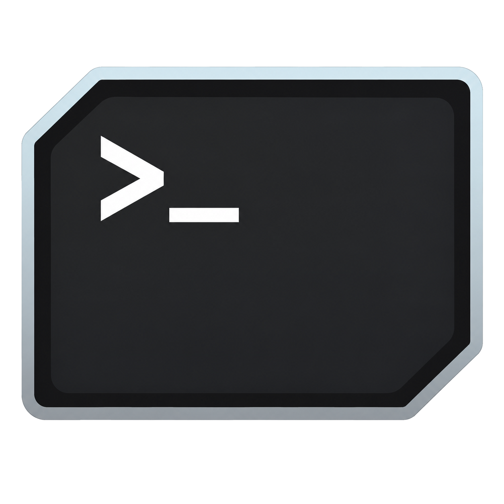
</p>

# Konsoll

A native terminal for macOS, built in QML (Qt Quick) on top of Qt 6.12.

Konsoll is a clean, native macOS terminal with a real pseudo-terminal (PTY)
running your default shell. It renders the screen
with a native Qt Quick scene-graph renderer, emulates a VT500-class terminal
with the modern xterm, kitty and iTerm2 extensions, and offers an
iTerm2-style see-through window with native Liquid Glass.

> Konsoll is Norwegian for "console".

## Install

Download `Konsoll-VERSION-arm64.dmg` (or `.zip`) from the
[Releases](https://github.com/rask-project/Konsoll/releases) page and move
`konsoll.app` to `/Applications`. Requires macOS 14.4+ on Apple Silicon.

The app is ad-hoc signed but not notarized by Apple, so Gatekeeper blocks the
first launch. Clear the quarantine flag once:

```sh
xattr -dr com.apple.quarantine /Applications/konsoll.app
```

or open it, then choose **System Settings → Privacy & Security → Open
Anyway**.

## Requirements

- macOS (Apple Silicon)
- Qt 6.12 (Qt Quick, Qt Quick Controls, Qt Quick Dialogs, Qt SVG)
- CMake 3.21.1+
- A C++23 compiler (AppleClang / Xcode command-line tools)

## Build

```sh
# Configure (point CMAKE_PREFIX_PATH at your Qt 6.12)
cmake -S . -B build -G Ninja \
    -DCMAKE_PREFIX_PATH=/path/to/Qt/6.12.0/macos-arm64/lib/cmake \
    -DCMAKE_BUILD_TYPE=Debug

# Build
cmake --build build --target konsoll
```

The app is produced at `build/konsoll.app`. (Qt Creator works too — it
generates the build directory itself.)

### Release bundle

The full build, signing, notarization, and packaging process is documented in
[`docs/RELEASE.md`](docs/RELEASE.md). To build the self-contained Release app:

```sh
cmake -S . -B build/release -G Ninja \
    -DCMAKE_PREFIX_PATH=/path/to/Qt/6.12.0/macos-arm64/lib/cmake \
    -DCMAKE_BUILD_TYPE=Release \
    -DCMAKE_OSX_ARCHITECTURES=arm64
cmake --build build/release --config Release --target package-macos
```

The complete, self-contained app bundle is
`build/release/dist/konsoll.app`. The build-tree app at
`build/release/konsoll.app` may still rely on the local Qt installation and
is not the distribution artifact.

## Run

```sh
./build/konsoll.app/Contents/MacOS/konsoll
```

On launch Konsoll detects your default shell (from the `passwd` entry) and
starts it in a PTY.

## Using Konsoll

<p align="center">
  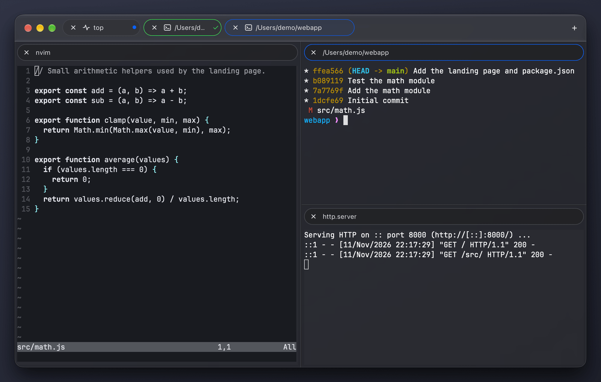
</p>

- [Keyboard shortcuts](#keyboard-shortcuts)
- [Editing the command line (Option + arrows, Backspace, Delete)](#editing-the-command-line)
- [Tabs (workspaces)](#tabs-workspaces)
- [Split panes](#split-panes)
- [Windows](#windows)
- [Selecting, copying and searching](#selecting-copying-and-searching)
- [Saving the buffer or a selection](#saving-the-buffer-or-a-selection)
- [Background Commands](#background-commands)
- [Settings](#settings)

### Keyboard shortcuts

On macOS, ⌘ is Command, ⌥ is Option, ⌃ is Control and ⇧ is Shift.

| Shortcut | Action | Menu |
| --- | --- | --- |
| ⌘N | New window | Window ▸ New Window |
| ⌥⌘W | Close window | Window ▸ Close Window |
| ⌘T | New tab (workspace) | Shell ▸ New Workspace… |
| ⇧⌘T | New tab with a name | Shell ▸ New Named Workspace… |
| ⌃Tab / ⌃⇧Tab | Next / previous tab, in the order you used them | — |
| ⌘D | Split the active pane side by side | Shell ▸ Split Horizontally |
| ⇧⌘D | Split the active pane top and bottom | Shell ▸ Split Vertically |
| ⌘W | Close the active pane (the tab closes with its last pane) | Shell ▸ Close Session |
| — | Close the whole tab | Shell ▸ Close Workspace |
| — | Send the active pane to the background | Shell ▸ Move Session to Background |
| ⇧⌘B | Open Background Commands | Window ▸ Background Commands |
| ⇧⌘A | List the AI agents running in every window | Window ▸ AI Agents |
| ⌘C / ⌘V | Copy the selection / paste | Edit ▸ Copy / Paste |
| ⌘A | Select everything (scrollback included) | Edit ▸ Select All |
| — | Save the buffer or the selection to a file | Edit ▸ Save Buffer or Selection… |
| ⌘F | Find in the scrollback | — |
| ⌃L | Clear the screen | Shell ▸ Clear |
| ⌃K | Clear the scrollback buffer | Shell ▸ Clear Buffer |
| ⌘-click | Open a link (`OSC 8` hyperlinks and URLs) | — |
| ⌘, | Settings | Konsoll ▸ Settings… |
| ⌘Q | Quit (asks first while commands are running) | Konsoll ▸ Quit Konsoll |

Konsoll asks before closing a pane, tab or window whose shell is still
running a command.

### Editing the command line

Konsoll sends the keys macOS users expect to the shell's line editor, so word
movement and word deletion work in zsh, bash and fish without any
configuration:

| Keys | Sends | What the shell does |
| --- | --- | --- |
| ⌥← | `Esc b` | Move the cursor one word left |
| ⌥→ | `Esc f` | Move the cursor one word right |
| ⌥⌫ (Option+Backspace) | `Esc DEL` | Delete the word before the cursor |
| ⌥⌦ (Option+Delete, or fn⌥⌫ on laptops) | `Esc D` | Delete the word after the cursor |
| ⌥. | `Esc .` | Insert the last argument of the previous command (repeat to go further back) |
| ⌫ / ⌦ | `DEL` / `CSI 3 ~` | Delete the character before / under the cursor |
| ⌃⌫ | `^H` | Backspace for the shell; editors such as Neovim can bind it on its own |
| ⇧↩ | `LF` | A new line inside the prompt of Claude Code, Codex and other TUIs, without submitting |
| ← → ↑ ↓, Home, End | cursor keys | Character movement, history, start / end of line |

<p align="center">
  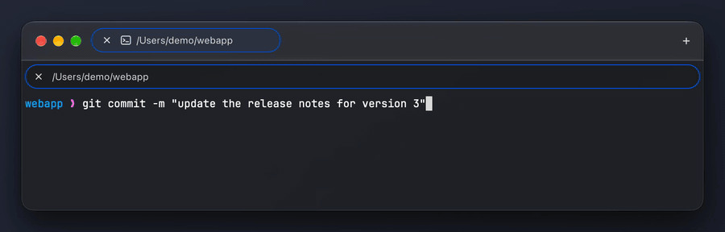
</p>

These word shortcuts work whether or not **Use Option as Meta key** is on
(Settings ▸ Keyboard). With it off (the default), Option+letter still types
the macOS special characters (Option+2 = ™, accents with dead keys); turn it
on when you want every Option+key to arrive as Alt/Meta in Emacs, tmux,
readline or Neovim. Programs that enable the kitty keyboard protocol or
xterm's modifyOtherKeys receive the full, unambiguous encoding of every key
instead.

### Tabs (workspaces)

Every tab is a workspace: one shell, or several split panes, with its own
running programs.

<p align="center">
  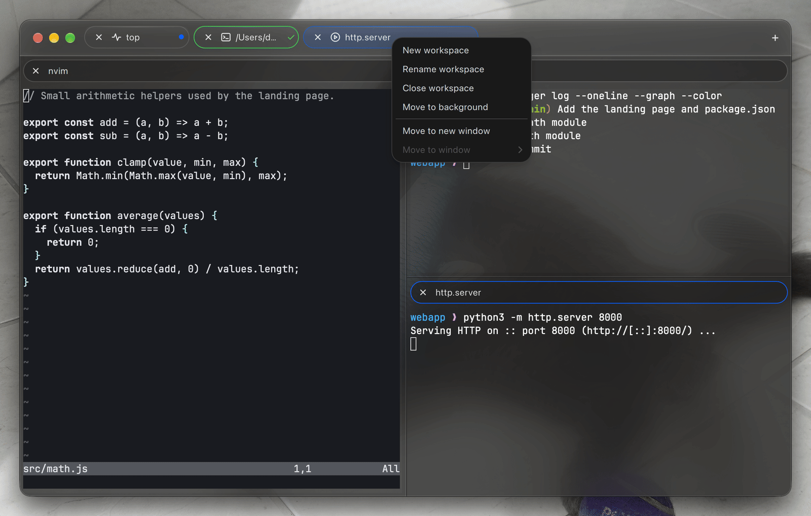
</p>

- **Open** a tab with ⌘T or the **+** button at the end of the tab strip;
  ⇧⌘T asks for a name first.
- **Switch** by clicking a tab, or with ⌃Tab / ⌃⇧Tab, which walk through the
  tabs in the order you last used them.
- **Reorder** by pressing and holding a tab until it lifts, then dragging it
  along the strip.
- **Right-click a tab** for *New workspace*, *Rename workspace*, *Close
  workspace*, *Move to background*, *Move to new window* and *Move to window
  ▸*.
- **Read the tab at a glance.** The icon shows the program running in the
  tab's active pane (ssh, editors, git, containers, REPLs, database clients,
  build tools, downloads, archives, package managers, searches, AI agents
  such as Claude Code…), a static "running" icon for any other command —
  nothing spins, so a long job costs no redraws — and a progress ring when
  the program reports progress (`OSC 9;4`).
  The title is the running command, or the shell's directory at the prompt.
  A tab in the background tells you why it wants a look: new output, a
  finished (✓) or failed (✗) command, or the bell.
- Double-clicking empty space in the tab strip zooms the window, like a
  title bar.

### Split panes

<p align="center">
  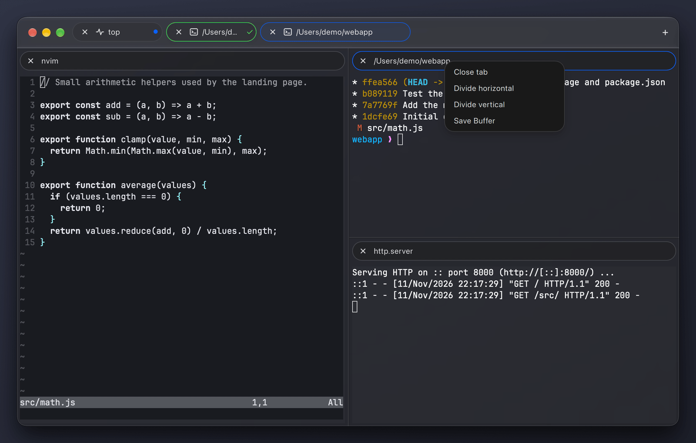
</p>

- **Split** the active pane with ⌘D (side by side) or ⇧⌘D (top and bottom),
  from the **Shell** menu, or by right-clicking inside a pane (*Split Side by
  Side* / *Split Top and Bottom*). Splits nest as deep as you like.
- **Each pane** is an independent shell with its own title bar (running
  command or directory) and close button. Right-click the title bar for
  *Close tab*, *Divide horizontal*, *Divide vertical* and *Save Buffer*.
- **Focus** a pane by clicking it; ⌘W closes the focused one.
- **Rearrange** by dragging a pane by its title bar and dropping it on another
  pane: drop on the left or right half to place them side by side, on the
  top or bottom half to stack them — that is also how two panes swap between
  a horizontal and a vertical split.
- **Promote a pane to a tab** by dropping it on a tab strip — in this window
  or another one — or tear it off into a new window by dropping it anywhere
  outside the windows.

<p align="center">
  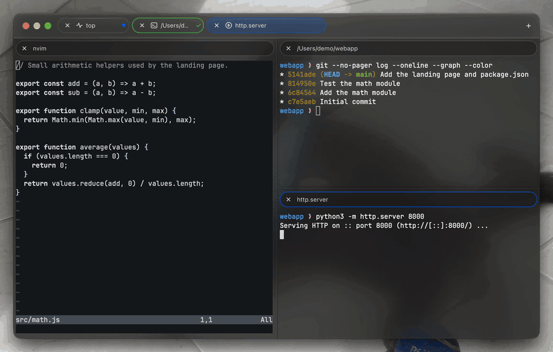
</p>

Moving a pane or a tab never restarts anything: the shell, its running
programs and its scrollback move with it.

### Windows

- **New window** with ⌘N. Every open window is listed in the **Window** menu;
  pick one to bring it forward.
- **Move a tab to another window** from its context menu (*Move to new
  window*, *Move to window ▸ name*), or **press and hold the tab and drag it
  out of the strip**: drop it on another window's tab strip to join its tabs,
  or anywhere else to tear it off into a window of its own.
- The last active window's size and position are restored on the next launch.
- The window is **see-through**: the terminal background, the title bar and
  the tab strip are tinted and blurred (native Liquid Glass on macOS 26).
  Opacity and blur are set in Settings ▸ Window.

<p align="center">
  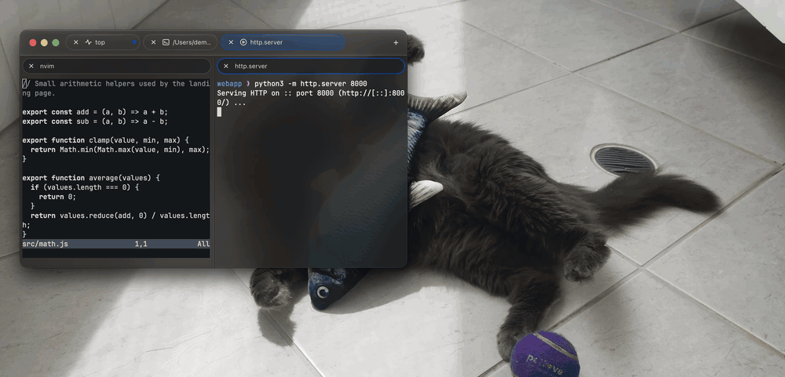
</p>

### Selecting, copying and searching

- **Select** by dragging; double-click selects a word, triple-click a line,
  ⌘A everything including the scrollback. ⌘C copies, ⌘V or a middle click
  pastes (as bracketed paste when the program asks for it).
- **Command blocks.** Konsoll loads its shell integration (`OSC 133`)
  automatically for zsh, bash and fish — it never edits your startup files.
  Clicking a command or one of its output lines highlights the whole block,
  and ⌘C copies it. Other shells keep single-line highlighting.

  <p align="center">
    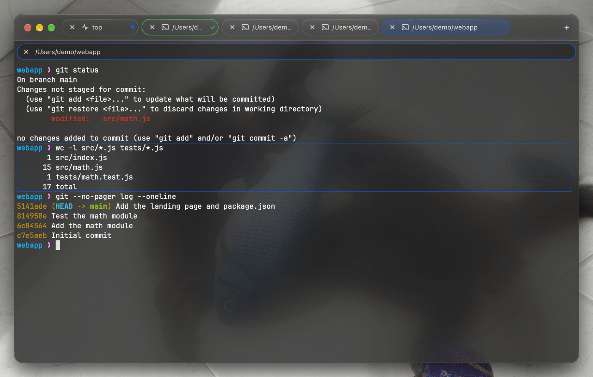
  </p>

- **Find** with ⌘F: type to search the whole scrollback — the counter shows
  the current match and the total, ↩ / ⇧↩ jump to the next / previous one
  (the view scrolls to it), `.*` switches to regular expressions and Esc
  closes the bar.
- **Images and files.** Pasting an image or dropping files into an SSH
  session uploads them to the remote host and inserts their remote path.
- The right-click menu inside a pane has Split, Save Buffer or Selection…,
  Copy, Paste, Select All and Clear Buffer.

<p align="center">
  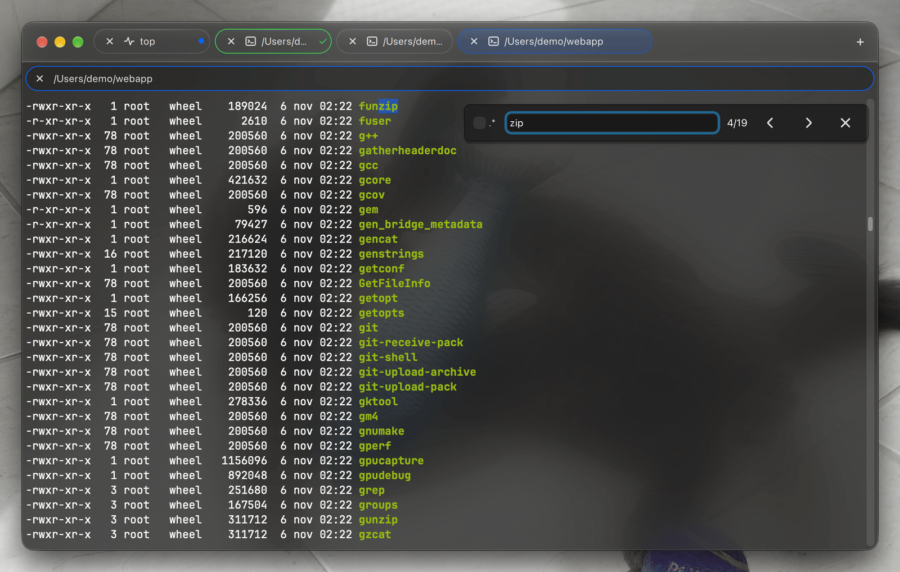
</p>

### Saving the buffer or a selection

Choose **Save Buffer or Selection…** from the **Edit** menu, from the
right-click menu inside a pane, or **Save Buffer** from a pane's title-bar
menu.

- With a **selection** (dragged text, a word, a line, or a highlighted
  command block), Konsoll saves just that text.
- **Without a selection**, it saves the whole buffer: the complete scrollback
  plus the visible screen.

A save dialog opens in **Downloads**; pick the file name and folder. The text
is written as UTF-8 (`.txt` by default).

<p align="center">
  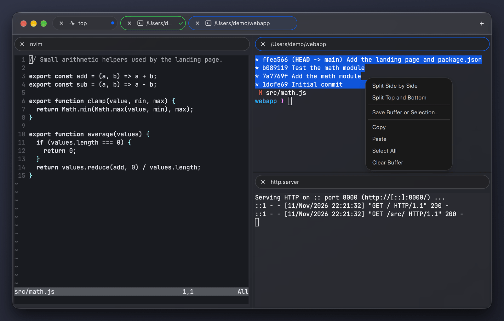
</p>

<p align="center">
  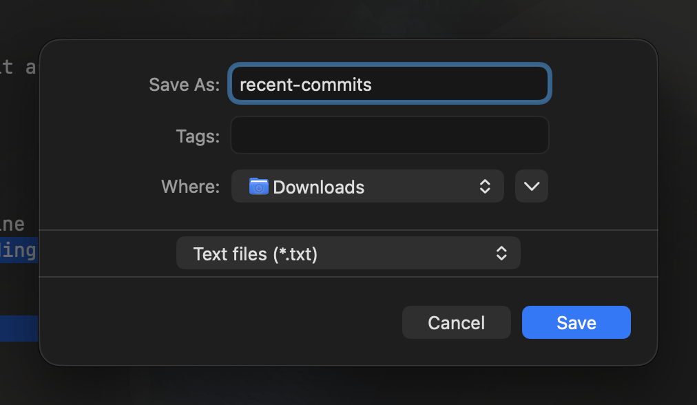
</p>

### Background Commands

Background Commands runs commands and shells **without a tab**: dev servers,
build watchers, tunnels, long jobs. Open it with ⇧⌘B or **Window ▸ Background
Commands**. Its sidebar has four sections.

#### Running

<p align="center">
  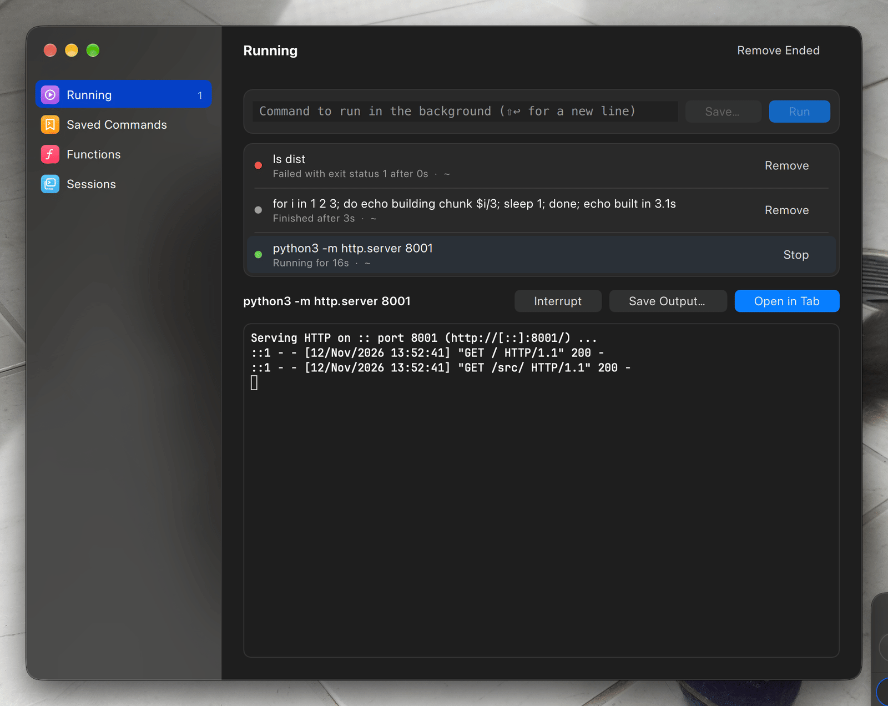
</p>

1. Type a command in the field at the top (⇧↩ adds a line) and press
   **Run** or ↩. It runs in your login shell as `$SHELL -i -c`, so your
   aliases, `PATH` and the functions defined in Konsoll are available.
2. Every job shows its state — *Running for…*, *Finished after…*, *Failed
   with exit status N…*, *Stopped after…* — and the selected job's **live
   output**.
3. For the selected job: **Interrupt** sends ⌃C, **Stop** ends it, **Run
   Again** restarts a finished command, **Save Output…** writes its output to
   a file and **Open in Tab** turns a running job into a regular tab in the
   active window.
   **Remove** / **Remove Ended** clear finished jobs from the list.
4. **Save…** next to Run opens the *Saved Commands* form with the command
   filled in.

A desktop notification tells you when a command ends on its own.

#### Saved Commands

<p align="center">
  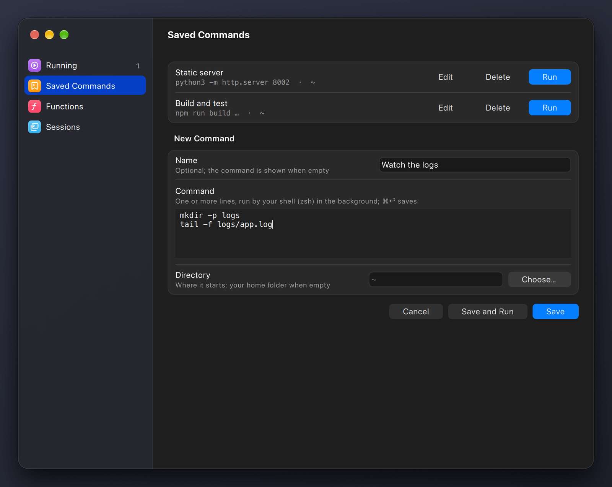
</p>

Keep the commands you start often and run them with one click:

1. Click **Add Command…**.
2. Fill in **Name** (optional — the command is shown when empty), **Command**
   (one or more lines, run by your shell) and **Directory** (where it starts;
   your home folder when empty, or **Choose…**).
3. **Save** (⌘↩), or **Save and Run** to start it right away.

Every saved command has **Run**, **Edit** and **Delete** buttons.

#### Functions

<p align="center">
  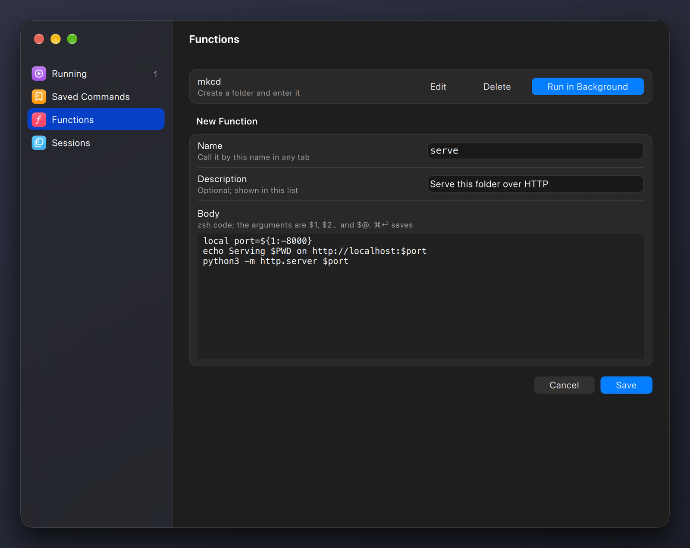
</p>

Define shell functions in Konsoll instead of in your `.zshrc` / `.bashrc` /
`config.fish`. Give each one a **Name**, an optional **Description** and a
**Body** in your shell's language (`$1`, `$2`… and `$@` are its arguments).
Every tab can call it — tabs that are already open pick it up at their next
prompt — and so can background and saved commands. **Run in Background**
runs a function as a background job.

#### Sessions

<p align="center">
  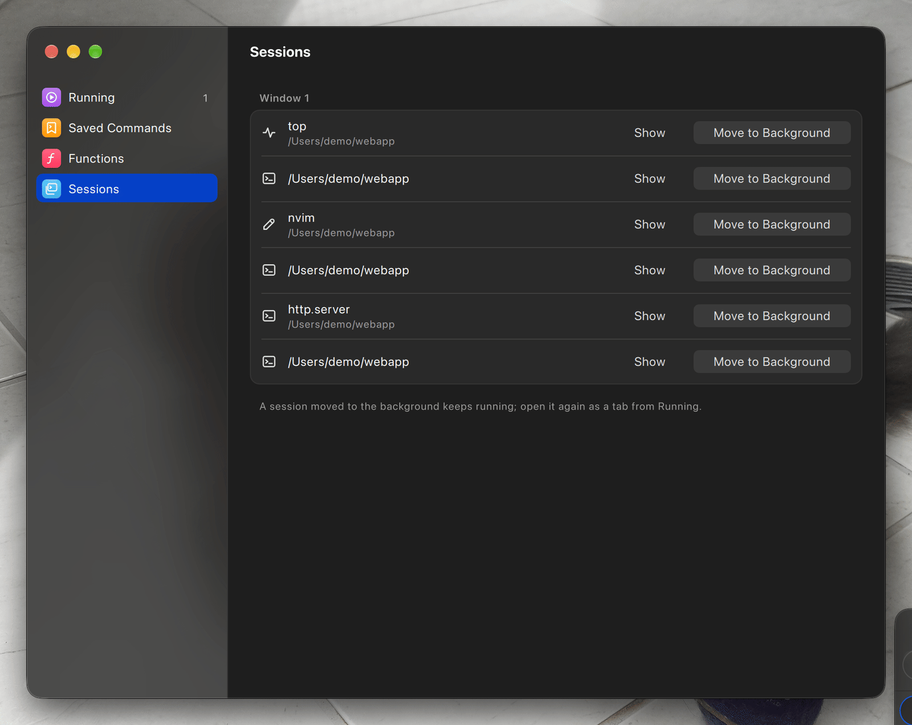
</p>

Lists every pane of every window. **Show** brings one forward; **Move to
Background** takes it out of its tab while it keeps running — it then appears
under *Running*, where **Open in Tab** brings it back. The same move is in a
tab's context menu (*Move to background*) and in **Shell ▸ Move Session to
Background**.

<p align="center">
  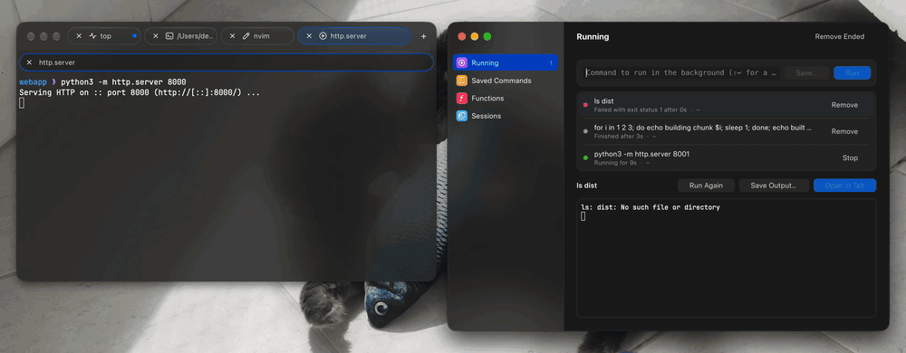
</p>

### AI agents

Konsoll recognizes AI coding agents (Claude Code, Codex, opencode, Qwen Code,
Gemini CLI, …) and gives their tab the agent icon. Once an agent is
connected, it also reports what it is doing, and the tab shows it:

| Icon | State |
| --- | --- |
| Sparkle (accent color) | Working on a turn |
| Speech bubble (amber) | Waiting for you: a permission prompt or a question |
| Sparkle with a check | Done with the turn |
| Sparkle with a cross (red) | Failed |

- **Agents in parallel.** **Shell ▸ New Agent in Worktree…** asks for an
  agent and a branch, creates a git worktree of the current pane's
  repository on it (beside the repository, in `<repo>-worktrees/`; an
  existing branch or worktree is reused) and starts the agent there in a new
  tab. Each agent works apart from your checkout, and Window ▸ AI Agents
  lists them all.
- **Send to Agent.** Right-click a pane: **Send Selection to Agent** and
  **Send Last Command to Agent** (the command, its exit status and output)
  paste into the agent's pane — the one in the same tab first — as its next
  prompt, ready for you to add a question and send.
- **Answer permission prompts from the notification.** When an agent asks
  to run a tool, the notification shows what it wants (the command, the
  file) with **Allow** and **Deny**: the answer goes to the agent's pane as
  if typed there (Enter for its first choice, Escape to refuse), without
  bringing Konsoll forward. **Window ▸ AI Agents** has the same buttons, the
  task each agent works on and how long it has waited; the Dock icon counts
  the agents waiting for you. Connected agents get it after **Update** in
  Settings ▸ AI Agents.

- **Connect an agent** from the pane: when you start an agent that is not
  connected yet, the pane offers to connect it (*Not Now* stops asking). Or
  in **Settings ▸ AI Agents**: *Connect* adds Konsoll's
  hooks to Claude Code (`~/.claude/settings.json`), Codex
  (`~/.codex/hooks.json`) or Qwen Code (`~/.qwen/settings.json`), keeping
  everything else in the file and a copy of it as `.konsoll-backup`;
  opencode gets a plugin file (`~/.config/opencode/plugins/konsoll.js`).
  *Remove* takes them out again. Restart agents already running; Codex runs
  new hooks only after you trust them with `/hooks`. The hooks do nothing
  outside Konsoll.
- **A background tab** flags a waiting agent like the bell, a finished turn
  with ✓ and a failure with ✗. Hovering the tab shows the agent's message
  (what it needs permission for). With several panes in a tab, the pane that
  most needs you sets the icon.
- **Notifications:** when an agent waits for you, finishes or fails while
  you are looking elsewhere, Konsoll posts a notification; clicking it brings
  that pane forward. Turn it off in Settings ▸ AI Agents.
- **Window ▸ AI Agents** (⇧⌘A) lists every pane running an agent, in every
  window, the ones waiting for you first, with **Show** to jump there.

**Konsoll tools for agents (MCP).** `konsoll --mcp` is an MCP server that
gives an agent running in Konsoll these tools, from the pane it runs in:

| Tool | What it does |
| --- | --- |
| `open_pane` | Opens a pane next to the agent's (right or below) running a command — a dev server, a watcher — without taking the focus. The pane stays when the command ends. |
| `run_in_background` | Starts a Background Command (Window ▸ Background Commands). |
| `background_job_status` | The state, exit code and last output of a background command that same agent started. |
| `recent_commands` | The last commands run in the agent's own pane before it started (your build, your tests), with exit status and output: "why did my build fail?" works without pasting anything. |
| `list_panes` | The panes of the agent's window: number, tab, program and directory — no output. |
| `read_pane` | Reads another pane (a dev server's log, a test run). The agent's pane asks you first (**Allow Once** / **Deny**, also on the notification); nothing is read without it. |

Register it once per agent: **Settings ▸ AI Agents ▸ Copy** gives the exact
command or configuration for this Konsoll. For the installed app:

```bash
claude mcp add --scope user konsoll -- /Applications/Konsoll.app/Contents/MacOS/konsoll --mcp
qwen mcp add --scope user konsoll /Applications/Konsoll.app/Contents/MacOS/konsoll --mcp
```

```toml
# ~/.codex/config.toml — Codex passes a server only the variables listed
[mcp_servers.konsoll]
command = "/Applications/Konsoll.app/Contents/MacOS/konsoll"
args = ["--mcp"]
env_vars = ["KONSOLL_SESSION_TOKEN", "KONSOLL_AGENT_SOCKET"]
```

```jsonc
// ~/.config/opencode/opencode.json
"mcp": { "konsoll": { "type": "local", "command": ["/Applications/Konsoll.app/Contents/MacOS/konsoll", "--mcp"] } }
```

Outside Konsoll the server offers no tools. It cannot read other panes.

Claude Code can use the Konsoll plugin instead of the hooks:

```bash
claude plugin marketplace add rask-project/Konsoll
claude plugin install konsoll@konsoll
```

Any other tool can report a state the same way: Konsoll exports
`KONSOLL_AGENT_HOOK`, a script that takes the agent's name, the state
(`working`, `waiting`, `idle`, `error` or `ended`) and an optional message:

```bash
"$KONSOLL_AGENT_HOOK" my-agent waiting "Approve the migration?"
```

### Settings

Open Settings with ⌘, (**Konsoll ▸ Settings…**). Changes apply to every
window right away and are saved automatically.

| Section | Options |
| --- | --- |
| **Appearance** | Font (family, size, weight, italic), cursor style (block, underline, bar, hollow block), blinking cursor |
| **Window** | Background blur, background opacity |
| **Terminal** | Scrollback: unlimited (the default) or a line limit |
| **Keyboard** | Use Option as Meta key |
| **AI Agents** | Connect Claude Code, Codex, Qwen Code and opencode to the tab status; notify when an agent needs you |
| **Security** | What programs may do: read the clipboard (`OSC 52`: never / ask / always), read the window title, show desktop notifications, move and resize the window |

<p align="center">
  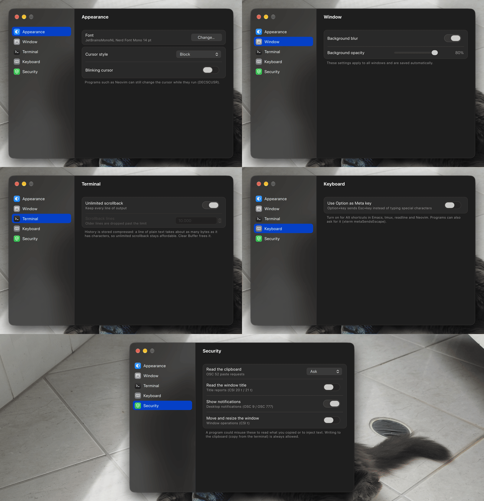
</p>

## Features

### Core terminal

- Real PTY via `forkpty()` running your login shell, one worker thread per
  session with output backpressure
- Default shell detection via `getpwuid_r` (fallback `/bin/zsh` → `/bin/sh`)
- Native scene-graph rendering (`TerminalRenderer`, C++) with ~60 fps
  coalescing; cell size measured from the font
- Window resize reflected into the PTY (`TIOCSWINSZ`)
- Unlimited scrollback with reflow on resize (images and double-size lines
  stay with their text), stored compressed: a line of plain text costs about
  one byte per character, and clearing the buffer returns the memory
- Unicode: wide characters (CJK, emoji) take two cells, zero-width marks take
  none, combining marks compose, and grapheme clusters (ZWJ sequences,
  skin tones, flags) are one cell with mode 2027
- Keyboard input with IME / dead keys (pt-BR accents)

### Terminal emulation

An in-house VT500-style state machine (no `libvterm`), validated against
`vttest` and Neovim/LazyVim:

- Every SGR attribute, with colon sub-parameters (curly/colored underlines,
  256 colors and truecolor), and background color erase
- Cursor, tab, erase, insert/delete, scroll regions, left/right margins,
  VT420 rectangular operations, DEC double-width/double-height lines,
  charsets (G0–G3, NRCS, DEC Special Graphics), reverse wraparound,
  132-column mode (DECCOLM), 8-bit C1 controls (S8C1T) and DECUDK
- Device, mode and cursor reports (DA1/2/3, DSR, DECRQM, DECRQSS, XTVERSION,
  XTGETTCAP) answered through an ordered reply queue
- Cursor shapes and blinking (DECSCUSR), focus reporting, synchronized output
- Keys encoded like xterm, with modifyOtherKeys and every kitty keyboard
  protocol enhancement (including the base layout key)
- Mouse reporting (X10/1000/1002/1003, SGR 1006, SGR-pixels 1016),
  horizontal wheel, highlight tracking and alternate scroll
- Bracketed paste
- Option as Meta (a setting, plus `?1036` / `?1039`)

### Images, links and shell integration

- Images: kitty graphics protocol (with animation and Unicode placeholders),
  sixel, and iTerm2 `OSC 1337` inline images
- `OSC 8` hyperlinks (⌘-click), `OSC 4/10/11/12` color control
- `OSC 52` clipboard (reads ask first by default)
- `OSC 9` / `OSC 777` desktop notifications, `OSC 9;4` progress in the tab
- AI agent state in the tab (working, waiting for you, done, failed) from the
  agent's hooks, connected from Settings for Claude Code, Codex, Qwen Code
  and opencode, with notifications and an agent list (Window ▸ AI Agents)
- `OSC 7` working directory, `OSC 133` / `OSC 633` command blocks, and the
  iTerm2 `OSC 1337` commands (user variables, current directory, …)
- `OSC 22` mouse pointer shapes

### Windows, tabs and split panes

- Multiple windows (`⌘N`), listed in the Window menu; the last active
  window's size and position are restored on the next launch
- Multiple tabs (workspaces) per window, each an independent shell session
  (`⌘T` / `⌘W`, named with `⇧⌘T`, `⌃Tab` / `⌃⇧Tab` to move through
  activation history); press and hold a tab to reorder it
- **Tab indicators** — an icon for the program running in the tab's last
  active pane (ssh and mosh, editors, system monitors, containers, REPLs,
  database clients, sudo, pagers, git, build tools, tmux, network
  transfers, archivers, package managers, searches, `sleep`, AI agents such
  as Claude Code, Codex and Qwen Code), a plain shell icon at the prompt, a
  static running icon for any other job, and an `OSC 9;4` progress ring.
  The tabs are drawn as glass panes over the strip. Next to it the tab (and the pane header) shows
  the running command's name, else the shell's directory. Double-clicking
  empty tab-strip space zooms the window (or follows the system's
  title-bar double-click setting). A background tab shows why it wants a look: new
  output, a finished (✓) or failed (✗) command (`OSC 133;D` exit status), or
  the bell
- Nested horizontal/vertical split panes (`⌘D` / `⇧⌘D`), each
  pane an independent session with its own title bar and close control
- **Move a workspace to another window** — right-click a tab and choose
  *Move to new window* or *Move to window ▸*, or drag the tab out of the
  strip: drop it on another window to join its tabs, or anywhere else to
  tear it off into a new window. The shells keep running.
- **Rearrange split panes by dragging** — drag a pane by its title bar and
  drop it on another pane: the left/right half splits side by side, the
  top/bottom half stacks them (so two panes can swap between a horizontal
  and a vertical split). Drop it on a tab strip to make it a workspace of
  its own — in this window or another one — or anywhere outside the windows
  to tear it off into a new window. The shell keeps running.
- **iTerm2-style see-through window** — the whole window (content + title
  bar) is translucent, tinted with the terminal's background color, with an
  optional blur; the tab strip uses native Liquid Glass on macOS 26

### Interaction

- Text selection (drag, double-click word, triple-click line, Select All)
- Clipboard copy/paste (text to the PTY; image paste uploads to an SSH host
  and inserts the remote image path; file drops upload to SSH sessions),
  context menu, Clear Screen (`⌃L`) and Clear Buffer (`⌃K`)
- Save the full terminal buffer or current selection to a UTF-8 text file
- macOS word editing: `⌥←` / `⌥→`, `⌥⌫`, `⌥⌦` and `⌥.` — see
  [Editing the command line](#editing-the-command-line)
- Scrollback navigation by wheel and scrollbar
- Scrollback search (`⌘F`; literal or regular expression, next/previous match)
- Native macOS menu bar (App / Shell / Edit / Window) and About dialog

### Background Commands and Settings

- Background Commands (`⇧⌘B`): running jobs with live output, saved
  commands, shell functions defined in Konsoll, and every session of every
  window — see [Background Commands](#background-commands)
- A native-looking Settings window (`⌘,`): font, cursor, window opacity and
  blur, Option as Meta, and what programs may do (clipboard reads, title
  reports, window operations, notifications) — see [Settings](#settings)

### Window translucency

The see-through look is driven by a configurable QML component:

```qml
WindowTranslucency {
    window: appWindow
    color: SessionManager.activeSession.backgroundColor   // tint = terminal bg
    alpha: 0.85
    blurEnabled: true
}
```

- `color` — the tint color, as a `uint` ARGB value (0xAARRGGBB). Bound to the
  active session's `backgroundColor` so it follows the terminal's background.
- `alpha` — the see-through level (0.85 ≈ the accepted `opacity: 0.85` look).
- `blurEnabled` — enables the native macOS window blur (enabled by default).

The native side is Objective-C++ (`src/MacOSTranslucency.mm`): it makes the
`NSWindow` non-opaque and sets its background to the tint color at the given
alpha. The QML `Window` must keep `color: "transparent"` so the backing
surface is transparent and the native tint shows through.

## Performance

Measured against iTerm2 3.7.7 on an Apple Silicon Mac with 8 GB of RAM
(macOS 27.2), both with unlimited scrollback, the same 48×199 window and
the same scripted scenarios:

| Scenario | Konsoll | iTerm2 |
| --- | --- | --- |
| Idle, 1 tab, window active | 0.5% CPU, 192 MB | 9.2% CPU, 242 MB |
| Idle, 10 tabs, window active | ~0% CPU, 235 MB | 7.0% CPU, 270 MB |
| `top` redrawing at 1 Hz | 1.1% CPU | 10.8% CPU |
| `yes \| head -n 5000000` (until the last byte is parsed) | 6.7 s | 8.4 s |
| `yes` for 15 s: peak memory, then after a clear | 483 MB, 192 MB | 13 GB, 885 MB |

History is stored compacted (a short line costs a few bytes), so unlimited
scrollback stays affordable, and clearing the buffer (⌃K) or closing a tab
returns the memory to the system. For the same output the macOS PTY alone
takes 6.1 s, so a burst is parsed close to the kernel's own limit. iTerm2
costs less per extra idle tab (+3.1 MB against +4.8 MB).

The method, every scenario and the fixes behind these numbers are in
[`docs/PERFORMANCE-FINDINGS.md`](docs/PERFORMANCE-FINDINGS.md).

## Testing

```sh
./build/konsoll.app/Contents/MacOS/konsoll --selftest
```

runs the parser checks (`src/parserselftest.cpp`), the recorded fixtures in
`tests/fixtures/` (a program's raw output and the screen it must produce)
and the multi-session tests against the real manager/backend/PTY stack.

- `konsoll --screen-dump ROWS COLS [--attrs]` prints the screen that stdin
  draws; `konsoll --render-dump ROWS COLS OUT.png` renders it with the real
  renderer.
- `tools/vtdrive.py` drives a program (vttest, nvim) in a PTY, answering its
  queries with Konsoll's replies; `tools/regress.py` checks or regenerates
  the fixtures.

## Project layout

```
konsoll/
├── CMakeLists.txt
├── main.cpp
├── Main.qml                  # app root: window list, moving workspaces/panes
├── TerminalWindow.qml        # window, menu bar, shortcuts, translucency
├── SettingsWindow.qml        # native-looking Settings window
├── BackgroundWindow.qml      # Background Commands window
├── AppSettings.qml           # persisted settings
├── TerminalWorkspace.qml     # per-tab workspace (split tree) + tab strip
├── TerminalPaneLayout.qml    # binary split layout for a workspace
├── TerminalView.qml          # hosts TerminalRenderer + keyboard capture
├── controls/                 # tab strip, menu, search bar, form/sidebar rows
├── shell-integration/        # OSC 133 snippets (zsh/bash/fish)
├── tests/fixtures/           # recorded regression fixtures
├── tools/                    # vtdrive.py, regress.py, format-code.sh
│   └── screenshots/          # docshot.sh: README screenshots and GIFs
├── resources/icons/          # SVG icon theme (add, arrows, close)
├── assets/                   # app icon (icns/png)
├── docs/
│   ├── RELEASE.md            # signing, notarization, packaging
│   ├── SCREENSHOTS.md        # how the README screenshots and GIFs are made
│   └── images/               # README screenshots and GIFs
└── src/
    ├── TerminalBackend.h/.cpp   # QML<->C++ bridge per session
    ├── TerminalManager.h/.cpp   # a window's workspaces, splits and sessions
    ├── WindowRegistry.h/.cpp    # the open windows' managers
    ├── BackgroundJobs.h/.cpp    # background commands and saved commands
    ├── ShellFunctions.h/.cpp    # shell functions defined in Konsoll
    ├── TerminalRenderer.h/.cpp  # scene-graph renderer for the cell grid
    ├── KeyEncoder.h/.cpp        # xterm / kitty key encoding
    ├── ProcessKind.h/.cpp       # foreground program -> tab icon kind
    ├── NativeKeyTracker.h/.cpp  # native key codes (kitty base layout key)
    ├── pty/
    │   ├── PtyProcess.h/.cpp    # forkpty, read loop, resize, exit
    │   └── PtyWorker.h/.cpp     # per-session worker thread
    ├── term/
    │   ├── Terminal.h/.cpp      # VT500 state machine + sequence handlers
    │   ├── TerminalReports.cpp  # device, mode and status reports
    │   ├── Screen.h/.cpp        # grid, scrollback, cursor, reflow
    │   ├── ScreenRect.cpp       # rectangular operations
    │   ├── Graphics.h/.cpp      # kitty, sixel and iTerm2 images
    │   ├── Grapheme.h/.cpp      # grapheme clusters, kitty placeholders
    │   ├── Charsets.h/.cpp      # G0–G3 and NRCS charsets
    │   ├── Palette.h/.cpp       # 256-color palette
    │   ├── CharWidth.h/.cpp     # wide-character table
    │   └── Cell.h               # cell struct
    ├── MacOSTranslucency.h/.mm  # native see-through window and glass views
    ├── WindowTranslucency.h/.cpp# QML type: configurable window translucency
    ├── GlassEffect.h/.cpp       # QML type: native Liquid Glass view
    ├── Notifications.h/.mm      # desktop notifications (UserNotifications)
    ├── NativeDialogs.h/.mm      # native alerts and prompts
    └── AboutDialog.h/.mm        # native About panel (Obj-C++)
```

## Scope

Windows, tabs, split panes, background commands, selection and clipboard,
scrollback search, the terminal emulation and image protocols above, and
shell integration are implemented. Still open: color profiles/themes,
ligatures and a configurable line height, and QML tests.
Obsolete VT features with no real-world use (VT320+ page memory, DECDLD
soft fonts, ReGIS) are deliberately left out.
